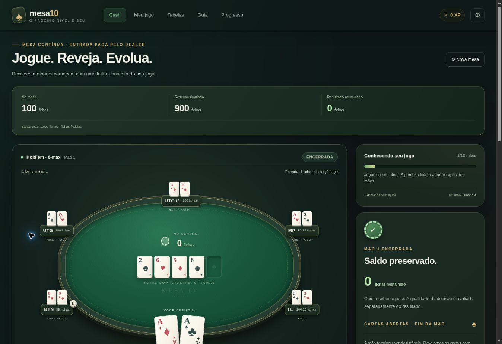

# ♠ Mesa 10

**Jogue. Reveja. Evolua.** · Treino de poker em português · PWA para iPhone e Android

[Guia de publicação](NETLIFY.md) · [Instalar no celular](PWA.md) · [Método](FONTES.md) · [Contribuir](CONTRIBUTING.md)



Treinador de cash game em português, com fichas fictícias. Mesa contínua de seis jogadores, calibração inicial de dez mãos e revisão baseada nas decisões registradas. Projeto estático, sem dependências de execução no navegador, preparado para GitHub e Netlify Functions.

## O que está implementado

- **Mesa contínua:** 100 fichas iniciais na mesa, 900 fichas de reserva, stacks mantidos entre mãos, reentrada pela reserva e histórico de resultados. Apostas, all-ins, potes laterais, empates e devoluções de apostas não pagas são contabilizados em centésimos de fichas.
- **Entrada do dealer:** o botão coloca 1 ficha como aposta inicial. Os demais precisam pagar, aumentar ou desistir; não há check gratuito para entrar no flop. O dealer já tem sua entrada paga e só completa a diferença se houver aumento. Não há small blind ou big blind nesta mesa. O botão gira a cada mão e a ação começa à sua esquerda: UTG, UTG+1, MP, HJ, CO e BTN.
- **Cartas e adversários:** baralho aleatório completo, sem favorecimento do herói; cinco bots com identidades e tendências persistentes, usando suas próprias cartas e a mesa revelada. Três ritmos: Mesa mista, Pressão alta e Imprevisível.
- **Todas as rodadas:** pré-flop, flop, turn e river, com apostas, aumentos e reaumentos legais. A mão pode terminar por desistência.
- **Cartas sempre abertas ao final:** os seis jogadores revelam suas cartas com animação, inclusive os que desistiram. No showdown, veja a melhor combinação de cinco cartas. Se a mão terminar antes, as rodadas não jogadas permanecem fechadas e o vencedor não muda. A revisão fica no histórico das novas mãos.
- **PWA:** ícones próprios, instalação na tela inicial, áreas seguras para notch e gestos, treino offline após o primeiro carregamento e atualização mediante clique, salvando a mão primeiro.
- **Omaha jogável:** a cada dez mãos, a décima é Omaha de quatro cartas, com limite de aumento pelo pote. Usa exatamente duas cartas próprias e três comunitárias. A análise de Omaha fica separada da de Hold’em.
- **Calibração inicial:** dez mãos geram uma primeira leitura. O painel Meu jogo apresenta frequências, oportunidades observadas, prioridades, evidências por mão e metas de estudo. Não significa treinar um modelo de IA nem determinar um estilo estável em dez mãos.
- **Treino direcionado:** refaça decisões que desviaram da referência, com o contexto disponível naquele momento. Os exercícios não mexem na banca e não contam outra vez para a calibração.
- **Animações:** cartas distribuídas e reveladas, fichas indo às apostas e ao pote, pagamentos aos vencedores e movimento do botão. Velocidades, pausa, pular até sua vez e respeito a movimento reduzido.
- **Banca e decisões separadas:** ganhar não prova que a escolha foi boa. Errar não gera multa artificial. O gráfico mostra o resultado das fichas fictícias, sem projeção de renda.
- **Gemini opcional:** análise das contagens e evidências mediante clique. Chave protegida no servidor. O jogo e o diagnóstico local funcionam sem API.
- **Continuidade:** a mão é salva durante o jogo. Mesas anteriores são arquivadas ao iniciar outra. Os exercícios e históricos da versão anterior foram preservados.

## Começar

O repositório é **[valock/mesa-10](https://github.com/valock/mesa-10)**. Para enviar os arquivos pelo próprio GitHub e conectar o Netlify, siga **[NETLIFY.md](NETLIFY.md)**. A documentação de publicação fica no repositório; a interface do app é dedicada ao treino.

| Netlify | Configuração |
| --- | --- |
| Build | `npm run build` |
| Pasta publicada | `dist` |
| Functions | `netlify/functions` |
| Node.js | 22 |
| Banco de dados | Não é necessário |

**iPhone:** abra o endereço HTTPS no Safari → Compartilhar → Adicionar à Tela de Início → ative “Abrir como App da Web”, se aparecer → Adicionar. **Android:** abra no Chrome → menu ⋮ → Instalar aplicativo ou Adicionar à tela inicial. O app também explica os passos em **Configurações → Mesa 10 no seu celular**. Consulte [PWA.md](PWA.md) para acesso offline e atualizações.

Use o endereço hospedado para instalar. O `mesa-10.html` é uma alternativa autônoma para treino em um navegador de computador; visualizadores de arquivos no iPhone podem não executar JavaScript. Esse arquivo não instala o PWA nem executa as Functions.

## Rodar no computador

Requer Node.js 22 ou superior. Não há dependências npm a instalar.

```sh
git clone https://github.com/valock/mesa-10.git
cd mesa-10
npm run build
npm run dev
```

Abra `http://localhost:4173`. Para encerrar o servidor, use Ctrl+C. O servidor local serve o treino; para executar também as Functions durante desenvolvimento, use o ambiente de desenvolvimento do Netlify. Nenhuma chave é necessária para jogar ou executar os testes.

## Método e limites

As tabelas são próprias e didáticas, inspiradas em princípios públicos de seleção por posição; não são saídas certificadas de solver. A entrada pelo dealer e os stacks variáveis alteram a estratégia: as referências são aproximações, não faixas resolvidas para cada situação.

No cash contínuo, a equidade pós-flop usa 200 amostras de Hold’em ou 120 de Omaha contra mãos uniformemente aleatórias dos adversários ativos. Não condiciona a faixa às apostas, ao perfil, à posição ou ao tamanho do stack. Não usa cartas adversárias ocultas ou comunitárias futuras para recomendar. O cálculo é ilustrativo: não estima realização de equidade, rake ou futuras apostas. Veja [FONTES.md](FONTES.md).

A qualidade da decisão é comparada com heurísticas próprias. Dicas e consulta às tabelas durante sua vez marcam a decisão como assistida. O diagnóstico de qualidade usa decisões sem ajuda; VPIP/PFR descrevem as mãos de Hold’em concluídas sob a regra atual. VPIP exclui a entrada obrigatória do dealer. A frequência do HUD é apostas ÷ (apostas + checks), separada por modalidade: não é AF, probabilidade de blefe ou certeza de estilo.

A IA sugere pontos de estudo. Nenhum resultado do simulador garante aumento de bankroll ou lucro em jogos reais.

## API e dados

- `GET /api/calibration` ou `/api/coach`: informa presença da configuração e modelo, sem revelar a chave. Não valida a chave no Google.
- `POST /api/calibration`: recebe somente contagens de Hold’em, número de mãos de Omaha, evidências enumeradas e ações públicas agregadas dos cinco adversários em Hold’em. Não envia cartas, perfil interno ou saldo.
- `POST /api/coach`: endpoint dos exercícios independentes anteriores, com contexto visível da mão e contagens; sem cartas ocultas ou futuras.
- Campos desconhecidos são descartados. Origem e tamanho do corpo são validados. Não há chat livre, chamadas automáticas a cada jogada ou repetição automática de tentativas.
- Respostas são estruturadas e escapadas na interface. Falha, timeout ou cota não impedem o treino local.
- Limites configurados: calibração 4 pedidos/minuto; coach anterior 6 pedidos/minuto, por IP/domínio. Corpo até 8 KiB e timeout do provedor de 18 segundos. Isso não é autenticação ou um teto global de custo.

Modelo padrão: `gemini-3.5-flash-lite`, alterável por `GEMINI_MODEL`. Em 01/11/2026, a documentação oficial lista Free Tier para esse modelo; disponibilidade e cotas dependem do projeto/região. Confira no AI Studio antes de publicar. No nível gratuito, os conteúdos podem ser usados para melhorar produtos do Google. O aplicativo não ativa faturamento. Nunca coloque uma chave real no Git, HTML, JavaScript público ou localStorage.

Progresso, histórico e bots ficam no `localStorage` do navegador. Trocar de dispositivo ou domínio não transfere os dados; limpar os dados remove o progresso. **Neon não é necessário nesta versão.** Uma evolução com sincronização deve incluir autenticação e isolamento por usuário antes de conectar o banco. `DATABASE_URL` deve ficar exclusivamente no servidor.

## Desenvolvimento e verificação

```sh
npm test
npm run build
python3 scripts/package-netlify.py
```

`npm run build` recompõe o HTML autônomo e o service worker. A versão do cache é calculada a partir do conteúdo dos arquivos, evitando manter uma versão manual. Execute-o depois de qualquer mudança na interface. O script Python recria o ZIP de exportação; não é necessário para o deploy pelo Git.

| Arquivo | Responsabilidade |
| --- | --- |
| `dist/cash.js` | Mesa contínua, regras de ação, saldo, pagamentos e referência |
| `dist/cash-coach.js` | Métricas, evidências, prioridades e validação do resumo |
| `dist/cash-ui.js`, `dist/cash.css` | Interface da mesa, animações e diagnóstico |
| `dist/pwa.js`, `dist/pwa.css` | Instalação, status offline, atualização e adaptação móvel |
| `dist/manifest.webmanifest`, `dist/icons/` | Identidade do PWA e ícones para iOS/Android |
| `scripts/service-worker.template.js` | Modelo do cache offline; gera `dist/sw.js` no build |
| `.github/workflows/ci.yml` | Testes e build em pushes e pull requests |
| `dist/engine.js` | Baralho, avaliação exata das mãos e motor dos exercícios anteriores |
| `dist/coach.js`, `dist/app.js`, `dist/style.css` | Base da aplicação e exercícios preservados |
| `netlify/functions/` | Integração Gemini no servidor |
| `tests/` | Regras, conservação de fichas, privacidade e API com provedor simulado |

A chamada real ao Gemini e o deploy na conta Netlify do usuário dependem da chave e da conta. Os testes de API usam um provedor simulado; não comprovam disponibilidade de uma chave real.

## Histórico e colaboração

As alterações estão em [CHANGELOG.md](CHANGELOG.md), incluindo a migração da entrada do dealer na versão 2.1 e o PWA na versão 2.2. Para colaborar, veja [CONTRIBUTING.md](CONTRIBUTING.md). Para comunicar vulnerabilidades e entender o tratamento das chaves, veja [SECURITY.md](SECURITY.md).

O histórico anterior é preservado. Mãos antigas que não registravam cartas dos adversários continuam disponíveis, mas não recebem cartas inventadas retroativamente.
