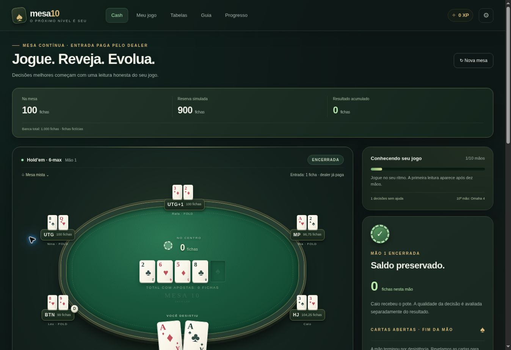

# ♠ Mesa 10 · v2.5.1

**Jogue. Reveja. Evolua.** · Treino de poker em português · PWA para iPhone e Android

[Guia de publicação](NETLIFY.md) · [Instalar no celular](PWA.md) · [Método](FONTES.md) · [Contribuir](CONTRIBUTING.md)



Treinador de cash game em português, com fichas fictícias. Mesa contínua de nove jogadores, calibração inicial de dez mãos e revisão baseada nas decisões registradas. Projeto estático, sem dependências de execução no navegador, preparado para GitHub e Netlify Functions.

## O que está implementado

- **Mesa em reais simulados:** cada entrada custa R$ 22,00: R$ 20,00 em fichas e R$ 2,00 de taxa inicial da casa. O resultado começa em −R$ 2,00. Reentradas adicionam R$ 20,00 às fichas e R$ 20,00 ao custo acumulado, sem repetir a taxa inicial, sem apagar perdas.
- **Blind exclusivo do dealer:** R$ 0,25 no Hold’em e R$ 0,50 no Omaha. O botão gira entre nove assentos; os demais pagam, aumentam ou desistem. O dealer só completa a diferença diante de um aumento. Não existem SB/BB adicionais nesta regra própria.
- **Rake:** 5% sobre o pote disputado total da mão quando for estritamente maior que R$ 10,00; arredondamento ao centavo mais próximo, sem teto, inclusive em mãos encerradas por desistência. Devoluções de apostas não pagas não entram na base. A taxa é repartida proporcionalmente entre potes principal/laterais antes do pagamento; o último recebe o ajuste de centavos. R$ 10,00 exatos são isentos. Essa estrutura é a regra solicitada para o simulador, não uma regra universal de cash.
- **Gráfico de lucro/prejuízo:** saldo líquido menos todas as entradas, com linha zero, taxas já descontadas, reentradas e tabela acessível por movimento. O histórico antigo permanece arquivado em fichas e não é convertido para reais.
- **Cartas e adversários:** baralho aleatório completo, sem favorecimento do herói; oito bots sentados, selecionados de 19 personagens com identidades e tendências persistentes, usando suas próprias cartas e a mesa revelada. Três ritmos: Mesa mista, Pressão alta e Imprevisível.
- **Todas as rodadas:** pré-flop, flop, turn e river, com apostas, aumentos e reaumentos legais. A mão pode terminar por desistência.
- **Cartas sempre abertas ao final:** os nove jogadores revelam suas cartas com animação, inclusive os que desistiram. No showdown, veja a melhor combinação de cinco cartas. Se a mão terminar antes, as rodadas não jogadas permanecem fechadas e o vencedor não muda. A revisão fica no histórico das novas mãos.
- **PWA:** ícones próprios, instalação na tela inicial, áreas seguras para notch e gestos, treino offline após o primeiro carregamento e atualização mediante clique, salvando a mão primeiro.
- **Omaha jogável:** a cada ciclo de dez mãos, a décima é Omaha (nove Hold’em + uma Omaha) de quatro cartas, com limite do pote apenas no pré-flop nas novas mãos. Usa exatamente duas cartas próprias e três comunitárias. A análise de Omaha fica separada da de Hold’em.
- **Calibração inicial:** dez mãos geram uma primeira leitura. O painel Meu jogo apresenta frequências, oportunidades observadas, prioridades, evidências por mão e metas de estudo. Não significa treinar um modelo de IA nem determinar um estilo estável em dez mãos.
- **Treino direcionado:** refaça decisões que desviaram da referência, com o contexto disponível naquele momento. Os exercícios não mexem na banca e não contam outra vez para a calibração.
- **Animações:** cartas distribuídas e reveladas, fichas indo às apostas e ao pote, pagamentos aos vencedores e movimento do botão. Velocidades, pausa, pular até sua vez e respeito a movimento reduzido.
- **Banca e decisões separadas:** ganhar não prova que a escolha foi boa. Errar não gera multa artificial. O gráfico mostra o resultado das fichas fictícias, sem projeção de renda.
- **Gemini opcional:** análise das contagens e evidências mediante clique. Chave protegida no servidor. O jogo e o diagnóstico local funcionam sem API.
- **Continuidade:** a mão é salva durante o jogo. Mesas anteriores são arquivadas ao iniciar outra. Os exercícios e históricos da versão anterior foram preservados.

## Começar

O repositório é **[valock/mesa-10](https://github.com/valock/mesa-10)**. Para enviar os arquivos pelo próprio GitHub e conectar o Netlify, siga **[NETLIFY.md](NETLIFY.md)**. A documentação de publicação fica no repositório; a interface do app é dedicada ao treino.

| Netlify | Configuração |
| --- | --- |
| Build | `npm run build` |
| Pasta publicada | `dist` |
| Functions | `netlify/functions` |
| Node.js | 22 |
| Banco de dados | Não é necessário |

**iPhone:** abra o endereço HTTPS no Safari → Compartilhar → Adicionar à Tela de Início → ative “Abrir como App da Web”, se aparecer → Adicionar. **Android:** abra no Chrome → menu ⋮ → Instalar aplicativo ou Adicionar à tela inicial. O app também explica os passos em **Configurações → Mesa 10 no seu celular**. Consulte [PWA.md](PWA.md) para acesso offline e atualizações.

Use o endereço hospedado para instalar. O `mesa-10.html` é uma alternativa autônoma para treino em um navegador de computador; visualizadores de arquivos no iPhone podem não executar JavaScript. Esse arquivo não instala o PWA nem executa as Functions.

## Rodar no computador

Requer Node.js 22 ou superior. Não há dependências npm a instalar.

```sh
git clone https://github.com/valock/mesa-10.git
cd mesa-10
npm run build
npm run dev
```

Abra `http://localhost:4173`. Para encerrar o servidor, use Ctrl+C. O servidor local serve o treino; para executar também as Functions durante desenvolvimento, use o ambiente de desenvolvimento do Netlify. Nenhuma chave é necessária para jogar ou executar os testes.

## Método e limites

As tabelas são próprias e didáticas, inspiradas em princípios públicos de seleção por posição; não são saídas certificadas de solver. A entrada pelo dealer e os stacks variáveis alteram a estratégia: as referências são aproximações, não faixas resolvidas para cada situação.

No cash contínuo, a equidade pós-flop usa 200 amostras de Hold’em ou 120 de Omaha contra mãos uniformemente aleatórias dos adversários ativos. Não condiciona a faixa às apostas, ao perfil, à posição ou ao tamanho do stack. Não usa cartas adversárias ocultas ou comunitárias futuras para recomendar. O cálculo é ilustrativo: não estima realização de equidade, rake ou futuras apostas. Veja [FONTES.md](FONTES.md).

A qualidade da decisão é comparada com heurísticas próprias. Dicas e consulta às tabelas durante sua vez marcam a decisão como assistida. O diagnóstico de qualidade usa decisões sem ajuda; VPIP/PFR descrevem as mãos de Hold’em concluídas sob a regra atual. VPIP exclui a entrada obrigatória do dealer. A frequência do HUD é apostas ÷ (apostas + checks), separada por modalidade: não é AF, probabilidade de blefe ou certeza de estilo.

A IA sugere pontos de estudo. Nenhum resultado do simulador garante aumento de bankroll ou lucro em jogos reais.

## API e dados

- `GET /api/calibration` ou `/api/coach`: informa presença da configuração e modelo, sem revelar a chave. Não valida a chave no Google.
- `POST /api/calibration`: recebe somente contagens de Hold’em, número de mãos de Omaha, evidências enumeradas e ações públicas agregadas dos cinco adversários em Hold’em. Não envia cartas, perfil interno ou saldo.
- `POST /api/coach`: endpoint dos exercícios independentes anteriores, com contexto visível da mão e contagens; sem cartas ocultas ou futuras.
- Campos desconhecidos são descartados. Origem e tamanho do corpo são validados. Não há chat livre, chamadas automáticas a cada jogada ou repetição automática de tentativas.
- Respostas são estruturadas e escapadas na interface. Falha, timeout ou cota não impedem o treino local.
- Limites configurados: calibração 4 pedidos/minuto; coach anterior 6 pedidos/minuto, por IP/domínio. Corpo até 8 KiB e timeout do provedor de 18 segundos. Isso não é autenticação ou um teto global de custo.

Modelo padrão: `gemini-3.5-flash-lite`, alterável por `GEMINI_MODEL`. Em 01/11/2026, a documentação oficial lista Free Tier para esse modelo; disponibilidade e cotas dependem do projeto/região. Confira no AI Studio antes de publicar. No nível gratuito, os conteúdos podem ser usados para melhorar produtos do Google. O aplicativo não ativa faturamento. Nunca coloque uma chave real no Git, HTML, JavaScript público ou localStorage.

Progresso, histórico e bots ficam no `localStorage` do navegador. Trocar de dispositivo ou domínio não transfere os dados; limpar os dados remove o progresso. **Neon não é necessário nesta versão.** Uma evolução com sincronização deve incluir autenticação e isolamento por usuário antes de conectar o banco. `DATABASE_URL` deve ficar exclusivamente no servidor.

## Desenvolvimento e verificação

```sh
npm test
npm run build
python3 scripts/package-netlify.py
```

`npm run build` recompõe o HTML autônomo e o service worker. A versão do cache é calculada a partir do conteúdo dos arquivos, evitando manter uma versão manual. Execute-o depois de qualquer mudança na interface. O script Python recria o ZIP de exportação; não é necessário para o deploy pelo Git.

| Arquivo | Responsabilidade |
| --- | --- |
| `dist/cash.js` | Mesa contínua, regras de ação, saldo, pagamentos e referência |
| `dist/cash-coach.js` | Métricas, evidências, prioridades e validação do resumo |
| `dist/cash-ui.js`, `dist/cash.css` | Interface da mesa, animações e diagnóstico |
| `dist/pwa.js`, `dist/pwa.css` | Instalação, status offline, atualização e adaptação móvel |
| `dist/manifest.webmanifest`, `dist/icons/` | Identidade do PWA e ícones para iOS/Android |
| `scripts/service-worker.template.js` | Modelo do cache offline; gera `dist/sw.js` no build |
| `.github/workflows/ci.yml` | Testes e build em pushes e pull requests |
| `dist/engine.js` | Baralho, avaliação exata das mãos e motor dos exercícios anteriores |
| `dist/coach.js`, `dist/app.js`, `dist/style.css` | Base da aplicação e exercícios preservados |
| `netlify/functions/` | Integração Gemini no servidor |
| `tests/` | Regras, conservação de fichas, privacidade e API com provedor simulado |

A chamada real ao Gemini e o deploy na conta Netlify do usuário dependem da chave e da conta. Os testes de API usam um provedor simulado; não comprovam disponibilidade de uma chave real.

## Histórico e colaboração

As alterações estão em [CHANGELOG.md](CHANGELOG.md), incluindo reais, rake e mesa de nove jogadores na versão 2.4.0. Para colaborar, veja [CONTRIBUTING.md](CONTRIBUTING.md). Para comunicar vulnerabilidades e entender o tratamento das chaves, veja [SECURITY.md](SECURITY.md).

O histórico anterior é preservado. Mãos antigas que não registravam cartas dos adversários continuam disponíveis, mas não recebem cartas inventadas retroativamente.

## Versões e próximos passos

Versão atual: **2.4.0**. Toda publicação deve atualizar `package.json`, este README e `CHANGELOG.md` juntos. O plano futuro está em [roadmap.md](roadmap.md): login, sincronização e ranking ainda não foram implementados.

As dicas usam fundamentos de GTO (preço líquido para pagar, faixas, posição e valor/blefe). As tabelas são aproximações didáticas herdadas de 6-max; não são soluções de solver para nove jogadores, blind no botão ou esta taxa. A calibração inicial continua em dez mãos (9 Hold’em e 1 Omaha nesse primeiro recorte), independentemente do ciclo de dez. A interface dos exercícios legados mantém as unidades e regras antigas, explicitamente identificadas no Guia.

Validação v2.4.0: testes de nove lugares, ciclo, apostas obrigatórias, rake/limiar, empates, potes laterais, all-ins, reentrada, recarga e API.

Reentradas de R$ 20,00 estão disponíveis entre mãos na aba Progresso, além da oferta automática quando o saldo é insuficiente. Os R$ 2,00 são cobrados somente ao iniciar uma nova mesa.

Apostas e aumentos voluntários devem ter total múltiplo de R$ 0,25. Botões de tamanho e bots usam esse passo. A única exceção é all-in com saldo exato, pois o rake e empates podem deixar centavos quebrados. No Omaha, o máximo continua limitado ao pote.

Na v2.4.0, Omaha ocorre nas mãos 10, 20, 30… A atualização mantém a modalidade e as cartas da mão já aberta, sem reiniciar banca, numeração ou histórico. Use “Salvar e atualizar” no PWA; não é preciso limpar dados nem abrir outra mesa.

## v2.4.0 · Casa do Gui
- Fundo fornecido pelo usuário, otimizado em WebP e incluído no cache offline e HTML autônomo. As marcas fazem parte da imagem enviada; não indicam parceria verificada pelo aplicativo.
- Elenco de 12 personagens fictícios: Guilherme, Ernane, Daniel, Joubert, Gustavo, Lucas, Neves, Vitor, Fernando, Maycon, Lucas (cunhado do Ernane) e Negued. Oito são sorteados para acompanhar você; Renan está ausente. Os estilos são inventados para treino, não avaliações das pessoas reais.
- Cada personagem tem ID, apelido, descrição, versão e parâmetros de comportamento. A mesa salva conserva seus bots até concluir a mão; a troca de elenco ocorre entre mãos sem alterar fichas ou histórico.
- Omaha: botão R$ 0,50; dealer é o primeiro a decidir no pré-flop. Pré-flop pot-limit, pós-flop sem limite. Frequência continua a cada dez mãos. Mãos anteriores abertas mantêm integralmente as regras antigas, inclusive o botão de R$ 1 e pot-limit nas rodadas seguintes.
- Comentários após a decisão, com linguagem brasileira respeitosa: desistência sem custo para continuar e diferenças amplas no preço/equidade estimada no river. Sem inventar precisão GTO, sem cartas ocultas e sem pontuação extra.
- Login WhatsApp, aprendizado de perfis humanos e ranking compartilhado são futuros: veja roadmap.md. Nenhum telefone ou modelo pessoal está sendo coletado ou compartilhado nesta versão.
- 65 testes, incluindo compatibilidade da mão salva, regras Omaha, personagens e comentários.


## v2.5.0 · Sessão da Casa do Gui

- Fundo com cores discretas e centro livre para as cartas; preservados marcotulio.pro (corretor de imóveis), iGUi Piscinas, Sankhya e LD Celulose. Arte fornecida pelo usuário e adaptada, sem afirmar patrocínio verificado.
- Elenco de 20 participantes contando você (19 personagens fictícios), nove assentos. Bot com stack zero é trocado entre mãos pelo próximo da fila; saldo pequeno continua elegível a all-in. A fila pode voltar a personagens já usados, cobrando apenas rebuy de R$ 20 na mesma sessão.
- Sessão padrão: 120 mãos, equivalentes a cinco horas simuladas a 24 mãos/h. Referência de cash full ring ao vivo: [PokerNews, 25–30 mãos/h](https://www.pokernews.com/strategy/transitioning-from-live-to-online-cash-games-37061.htm). Escolha conservadora do produto para mesa caseira mista; não é cronômetro real nem garantia de velocidade. São 108 Hold’em e 12 Omaha.
- Ao terminar a última mão e pagar todos os potes, a sessão fecha automaticamente. Mostra saldo devolvido, investimento acumulado, resultado líquido e XP de mesa; bloqueia nova mão e rebuy. O saldo é um registro simulado, sem transação financeira. Recarregar não duplica o fechamento.
- XP de mesa: 1 por mão disputada + `floor(max(0, lucro líquido em reais))`. Lucro líquido = saldo devolvido − entradas (inclui R$ 2 inicial e rebuys). Não há bônus por prejuízo. Os pontos de estudo (20/5 por resposta) ficam separados do ranking de mesa, mas o cabeçalho mostra o total pessoal.
- Ranking local acumulado por identidade nas sessões concluídas, inclusive bots. Ordenação: XP, resultado líquido, ID estável. Mesas incompletas não dão bônus de fechamento. WhatsApp, sincronização e ranking público validado continuam futuros.
- Quando seu saldo for insuficiente, escolha rebuy de R$ 20 ou sair e acompanhar com outro personagem no assento. Seu resultado congela na saída; as mãos seguintes não somam participação nem decisões suas.
- Compatibilidade: cartas, saldo, investimentos e histórico do jogo aberto permanecem. Mesas antigas acima de 120 mãos concluem a mão aberta (ou uma próxima se já estavam entre mãos). Para bots de mesas antigas, o saldo no início da mão corrente vira a base de fichas da nova contabilidade, somada a R$ 2 de entrada; não se inventam rebuys históricos. Participação anterior dos bots não gera XP retroativo.
- Verificações cobrem fechamento, bloqueio após limite, recarga idempotente, substituições, centavos restantes, estatísticas por identidade, rebuy, espectador e migração.


## v2.5.1 · Mesa no iPhone/PWA

- Feltro horizontal com a proporção original da arte (1672:941), sem esticar patrocinadores.
- Mesa compacta no celular, oito adversários ao redor e cartas do usuário dentro do painel; ações abaixo da mesa, com alvos de toque de pelo menos 44 px nos comandos principais.
- Com o celular deitado, mesa e ações lado a lado; o foco acompanha a rotação sem forçar orientação ou reiniciar a mão.
- Posições de apostas e animações usam as mesmas coordenadas responsivas dos jogadores. Preservadas áreas seguras do PWA e navegação inferior em retrato.
- Verificação de layout em viewports 375×667, 390×844, 844×390 e 932×430 no navegador de QA; validação em dispositivo iOS físico não realizada. Estado salvo, regras e pontuação não foram alterados.
